  

# 🛡️ Awesome Global Compliance Management   

> 🌐 A comprehensive, curated collection of top-tier Enterprise SaaS solutions and open-source tooling for **Global Compliance Management**, **GRC (Governance, Risk, and Compliance)**, **Regulatory Change Intelligence**, **Continuous Control Monitoring**, and **Multi-Jurisdictional Audit Readiness** (GDPR, ISO 27001, SOC 2, HIPAA, FedRAMP, NIS2, DORA).

📅 **Last updated:** October 2026

---

## 📑 Table of Contents

- [📊 Sector Overview & Market Dynamics](#-sector-overview--market-dynamics)
- [☁️ SaaS / Hosted Platforms](#️-saas--hosted-platforms)
- [🔓 Open-Source GitHub Projects](#-open-source-github-projects)
- [🧩 Frameworks for Building Custom Systems](#-frameworks-for-building-custom-systems)
- [🤝 How to Contribute](#-how-to-contribute)
- [💖 Support](#-support)
- [📈 Star History](#-star-history)
- [⚠️ Disclaimer](#️-disclaimer)

---

## 📊 Sector Overview & Market Dynamics

📈 The global Governance, Risk, and Compliance (GRC) and enterprise compliance software market is estimated at **$51 billion to $65 billion in 2025** and projected to exceed **$70 billion to $80+ billion by 2026–2027**, expanding at a 10%–14% CAGR (with automated compliance sub-segments expanding at over 25% annually).  

🧩 The sector is **moderately to highly fragmented** rather than winner-take-all: no single vendor commands more than 5% global market share, with the landscape divided between legacy enterprise GRC suites (MetricStream, Archer, Diligent), specialized domain leaders (Workiva for financial/SOX/SEC reporting, OneTrust for privacy/consent), and modern continuous compliance automation challengers (Vanta, Drata, Comp AI).

---

## ☁️ SaaS / Hosted Platforms

🏆 Leading enterprise cloud platforms sorted in descending order by enterprise company scale (market capitalization / valuation / annual revenue).

| 🏢 Platform | 💰 Enterprise Scale (Valuation / Revenue) | 🏷️ Pricing (Starting Tier) | ⏳ Free Tier / Trial Limits | 🔍 Key Capabilities & Compliance Focus |
| :--- | :--- | :--- | :--- | :--- |
| **[Workday Global Compliance](https://www.workday.com/)** | **~$50.6B Market Cap** (~$8.4B ARR) | From **$100,000/year** (core HCM packages typically $35–$100/user/month; enterprise annual contracts scale from $100k+ to $2M+) | **No free tier or trial for core HCM/Compliance suite** (custom sales POC only; 30-day trial available only for Workday Adaptive Planning) | 💼 Enterprise ERP/HCM compliance suite covering SOX internal controls, audit trails, policy management, workforce governance, and multi-country regulatory reporting. |
| **[Diligent](https://www.diligent.com/)** | **~$7.0B Valuation** (~$600M ARR) | From **$5,000/year** (basic board portal/governance modules start at $5k/yr; median enterprise GRC deployments range $15,000–$35,000+/year) | **No self-serve free trial or free tier** (facilitated product demos and guided pilot sandboxes available via sales consultation) | 📋 Diligent One Platform unifies governance, risk, and compliance with modules for board management, risk assessments, internal controls, audit tracking, and ESG reporting. |
| **[Workiva](https://www.workiva.com/)** | **~$4.4B Market Cap** (~$885M Annual Revenue) | From **$35,000/year** (baseline solution bundles start at $35k–$60k/yr; enterprise multi-entity reporting routinely exceeds $100k+/year) | **No free trial or free tier** (sales-led guided demonstration and custom evaluation environments provided upon request) | 📊 Regulatory reporting and financial compliance platform with ICFR, SOX compliance, ESG disclosures, and SEC filing automation with verifiable audit data linkage. |
| **[OneTrust](https://www.onetrust.com/)** | **~$4.5B Valuation** (~$550M ARR) | From **$10,000/year** (enforces a $10k annual spend floor; privacy/cookie modules start ~$827–$1,100/month; enterprise GRC suites scale $50k–$150k+/year) | **No self-serve free trial or free tier for core platform** (guided proofs of concept available via sales team; basic isolated web inspection utilities free) | 🔐 Enterprise trust intelligence and GRC platform orchestrating data privacy (GDPR, CCPA), AI governance, third-party risk management (TPRM), and continuous compliance monitoring. |
| **[Archer](https://www.archerirm.com/)** | **~$2.0B+ Valuation** (~$220M Annual Revenue) | From **$14,000/year** (entry-level single use-case licenses start ~$14k/yr; standard enterprise multi-module IRM suites start at $55,000–$80,000+/year) | **No free trial or free tier** (evaluations require custom scoping calls, proof-of-concept setups, and guided enterprise software demos) | 🎯 Integrated Risk Management (IRM) platform featuring centralized risk registers, regulatory compliance mapping, automated control monitoring, and audit-ready trails. |
| **[SAI360](https://www.sai360.com/)** | **~$800M–$1.0B Valuation** (~$150M–$250M ARR) | From **$35,000/year** (core standalone modules start at $35k/yr; full enterprise risk, EHS, and ethics suites range $75,000–$200,000+/year) | **No free trial or free tier** (evaluations conducted exclusively via vendor-guided product walkthroughs and customized pilot configurations) | 🌿 Unified GRC, Environment Health and Safety (EHS), and ethics platform delivering regulatory change management, policy lifecycles, and integrated employee compliance training. |
| **[MetricStream](https://www.metricstream.com/)** | **~$478M Valuation** (~$100M+ ARR) | From **$75,000/year** (baseline enterprise modules start at $75k/yr; mid-to-large multi-module deployments range $250k–$750k+/year; named seats $2k–$8k/user/yr) | **No free trial or free tier** (enterprise demonstrations and tailored proof-of-concept sandboxes coordinated via sales engineering) | 🤖 AI-powered GRC platform recognized across Chartis GRC categories; delivers autonomous evidence collection, regulatory change tracking, cyber risk quantification, and audit management. |
| **[LogicGate](https://www.logicgate.ai/)** | **~$250M–$300M Valuation** (~$50M ARR) | From **$13,000/year** (entry single-app packages start ~$13k–$14k/yr; median enterprise Risk Cloud deployment is $52,000–$54,000/year based on power users) | **No free trial or free tier** (interactive workflow walkthroughs and custom sandboxes provisioned via sales consultations) | ⚡ Risk Cloud platform featuring no-code GRC workflow automation, AI GRC agents, automated control testing, vendor risk management (TPRM), and MCP server connectivity. |
| **[RadarFirst](https://www.radarfirst.com/)** | **~$40M–$60M Valuation** (~$8M–$10M Annual Revenue) | From **$12,000/year** (enterprise incident response packages typically start at $12k–$25k/yr based on incident volume and jurisdiction tier) | **No free trial or free tier** (custom guided product demonstrations and incident evaluation assessments available via sales) | 🚨 Privacy and security incident response platform with automated multi-jurisdictional breach notification decisioning, statutory compliance clocks, and risk assessment workflows. |
| **[Compliance.ai](https://www.compliance.ai/)** | **~$20M–$30M Valuation** (~$5M ARR; Archer Subsidiary) | From **$15,000/year** (financial compliance regulatory feeds typically start at $15k–$25k/year based on jurisdictions, regulatory bodies, and seat counts) | **No free trial or free tier** (regulatory intelligence platform access arranged via guided demonstration and pilot access through Archer) | 📡 AI regulatory intelligence engine monitoring thousands of global regulatory bodies, classifying legal publications, and mapping statutory changes to organizational internal controls. |

---

## 🔓 Open-Source GitHub Projects

⭐ Curated open-source global compliance, continuous control monitoring, and GRC software repositories, sorted in descending order by GitHub stargazers.

- **[Prowler](https://github.com/prowler-cloud/prowler)**   
  ☁️ Open-source cloud security and compliance posture management tool (Apache-2.0) for AWS, Azure, GCP, and Kubernetes. Automates continuous control assessments against CIS Benchmarks, SOC 2, ISO 27001, HIPAA, GDPR, PCI-DSS, FedRAMP, and NIST 800-53 with audit-ready reporting.

- **[Open Policy Agent (OPA)](https://github.com/open-policy-agent/opa)**   
  📜 General-purpose policy engine (Apache-2.0, CNCF Graduated) enabling policy-as-code and compliance guardrail enforcement across cloud-native environments, Kubernetes admission controllers, microservices, and CI/CD pipelines using the declarative Rego query language.

- **[Checkov](https://github.com/bridgecrewio/checkov)**   
  🏗️ Static code analysis engine (Apache-2.0) for Infrastructure-as-Code (Terraform, CloudFormation, Kubernetes, Helm, Dockerfile). Scans for compliance regressions and maps cloud infrastructure misconfigurations directly against SOC 2, HIPAA, ISO 27001, and CIS benchmarks before deployment.

- **[Netflix Security Monkey](https://github.com/Netflix/security_monkey)**   
  🐒 Foundational open-source monitoring and policy tracking system (Apache-2.0) created by Netflix to inspect multi-account cloud assets, alert on policy changes, track historical drift, and ensure regulatory baseline compliance.

- **[CISA ScubaGear](https://github.com/cisagov/ScubaGear)**   
  🔍 Cybersecurity and Infrastructure Security Agency (CISA) verification engine for Microsoft 365 security and regulatory compliance. Automatically assesses tenants against CISA baseline policies, NIST SP 800-53 controls, and federal compliance baselines.

- **[Comp AI (Community Edition)](https://github.com/trycompai/comp)**   
  ✨ Free, open-source AI-native compliance automation platform (AGPLv3) designed for SOC 2, ISO 27001, HIPAA, and GDPR. Automates audit evidence collection, policy management, and control implementation directly on your self-hosted infrastructure.

- **[Probo](https://github.com/getprobo/probo)**   
  🛡️ Self-hostable enterprise GRC platform (ISC licensed) built for SOC 2, GDPR, and ISO 27001. Provides risk registers, vendor risk management (TPRM), data protection impact assessments (DPIA), access reviews, 270+ MCP tools for agent automation, and cryptographically immutable audit logs.

- **[Ansible Lockdown](https://github.com/ansible/ansible-lockdown)**   
  🔒 Automated compliance remediation playbooks (GPLv3) maintaining alignment with DISA STIGs and CIS Benchmark controls across Linux and Windows operating systems. Translates compliance audit requirements into self-healing infrastructure automation.

- **[Compliance Masonry](https://github.com/opencontrol/compliance-masonry)**   
  🧱 CLI tool (Apache-2.0) leveraging the OpenControl schema to construct machine-readable System Security Plans (SSP) and compliance documentation. Maps internal organizational controls to NIST 800-53, FedRAMP, and international compliance frameworks.

- **[The Openlane Core](https://github.com/theopenlane/core)**   
  🚀 Permissive open-source compliance automation platform (Apache-2.0) serving as a self-hosted alternative to Vanta and Drata. Supports SOC 2, GDPR, ISO 27001, and NIST 800-53 with fine-grained authorization via OpenFGA, Go, and PostgreSQL.

- **[MITRE Heimdall2](https://github.com/mitre/heimdall2)**   
  🖥️ Enterprise visual compliance dashboard (Apache-2.0) developed by MITRE for aggregating, viewing, and exporting multi-framework security and compliance evaluation results from InSpec, OpenSCAP, and automated scanners.

- **[MITRE SAF (Security Automation Framework)](https://github.com/mitre/saf)**   
  🛠️ CLI and developer toolkit (Apache-2.0) streamlining end-to-end security and compliance validation. Normalizes vulnerability and compliance scanning results across disparate tools into standardized OSCAL and Heimdall data formats.

- **[Conformiti](https://github.com/dboudreau00/Conformiti)**   
  📑 Open-source GRC compliance tool for SaaS products managing the full audit lifecycle. Pre-loaded with SOC 2, ISO 27001:2022, and PCI DSS v4.0.1 control libraries (217 controls), document-segregated evidence trees, and an immutable in-app audit trail.

- **[Lula](https://github.com/defenseunicorns/lula)**   
  🦄 Compliance-as-code validation engine (Apache-2.0) built on OSCAL (Open Security Controls Assessment Language). Bridges Kubernetes cloud infrastructure state with automated compliance evidence generation and non-conformance detection.

- **[Evidentia](https://github.com/Polycentric-Labs/evidentia)**   
  🏛️ Open-source GRC platform tailored for FedRAMP High, CMMC Level 2, and EU sovereign cloud environments. Native OSCAL architecture with CI-driven gap analysis GitHub Actions, AI-assisted risk statement generation, and Sigstore cryptographic evidence signing.

- **[GRCX](https://github.com/grcx-dev/grcx)**   
  📡 Regulatory radar for financial compliance teams monitoring publications from BoE, FCA, MAS, SEC, and ESMA. Employs LLM-driven control mapping, severity scoring, and a cryptographically chained append-only SHA-256 audit log.

- **[Cairn](https://github.com/frousselet/cairn)**   
  ⏳ Self-hosted GRC platform (GNU AGPL) covering ISO 27001 governance, ISO 27005 risk analysis, inter-framework requirement mapping, Trust Center publishing, REST/MCP agent APIs, and statutory incident notification countdown clocks (GDPR, NIS2, DORA).

---

## 🧩 Frameworks for Building Custom Systems

🛠️ To build a production-grade, self-hosted global compliance platform with zero vendor lock-in, combine specialized components:

* 📡 **Regulatory Change Tracking & Feed Ingestion:** Use **[GRCX](https://github.com/grcx-dev/grcx)** to monitor global regulatory feeds (FCA, SEC, BoE, ESMA) and map legal updates to internal controls.
* 🛡️ **Core Governance, Risk & Incident Management:** Deploy **[Cairn](https://github.com/frousselet/cairn)** or **[Probo](https://github.com/getprobo/probo)** for multi-framework compliance management, nonconformity tracking, and statutory incident clocks.
* ⚙️ **Continuous Control Monitoring & Evidence Automation:** Integrate **[Comp AI](https://github.com/trycompai/comp)**, **[The Openlane Core](https://github.com/theopenlane/core)**, or **[Prowler](https://github.com/prowler-cloud/prowler)** for automated cloud evidence collection across SOC 2, ISO 27001, and HIPAA.
* 📜 **Compliance-as-Code & OSCAL Portability:** Implement **[Evidentia](https://github.com/Polycentric-Labs/evidentia)**, **[Lula](https://github.com/defenseunicorns/lula)**, or **[Open Policy Agent (OPA)](https://github.com/open-policy-agent/opa)** for CI/CD pull request gate checks and machine-readable OSCAL evidence signing.

---

## 🤝 How to Contribute

🙌 Contributions are welcome! Here is how you can help:

1. 🍴 Fork the repository.
2. 📝 Add or update entries in `README.md` keeping the tabular and stargazer sorting standards intact.
3. 🔗 Include: Product name, authoritative official link, pricing tier, free tier/trial conditions, and 1–2 factual sentences describing compliance capabilities.
4. 🚀 Submit a Pull Request with a concise explanation.

---

## 💖 Support

🙏 Thank you for using and exploring **Awesome Global Compliance Management**!  

If you find this repository valuable:
- ⭐ **Star this repository** to help others discover it!
- 🍴 **Fork it** to contribute new tools and stay updated with compliance regulations.
- 📢 **Share it** with fellow compliance officers, security engineers, and DevOps practitioners.
- ☕ **Buy me a coffee / Sponsor**: If you would like to support ongoing curation and maintenance, visit the [GitHub Sponsors Dashboard](https://github.com/sponsors/ishandutta2007). Every bit of support is deeply appreciated!

---

## 📈 Star History

---

## ⚠️ Disclaimer

- 📌 This repository is a **community-curated index** created for informational purposes and does not represent an endorsement or legal advisory.
- ⚖️ Compliance platforms handling sensitive regulatory data, employee records, or audit evidence must strictly observe privacy and residency laws across applicable operating jurisdictions.
- 📄 Verify open-source software licenses before enterprise deployment (licenses range from permissive Apache-2.0/ISC to copyleft GNU AGPLv3).

---

**👔 Built for Chief Compliance Officers (CCO), GRC Directors, Risk Management Engineers, and DevSecOps Teams.**  
*🌐 Empowering organizations with open, transparent, and auditable global compliance management.*

